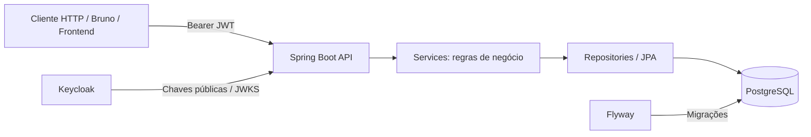

# Banking API

**API REST para gestão de clientes, contas bancárias, saldos, transferências e extractos**, desenvolvida com Java e Spring Boot. O projecto demonstra práticas de desenvolvimento backend aplicadas ao domínio bancário, incluindo autenticação com Keycloak, autorização por perfil e titularidade, persistência relacional, migrações de base de dados e rastreabilidade de operações.

> **Âmbito:** projecto de demonstração técnica (*MVP*). Não é um sistema bancário de produção. A criação de utilizadores no Keycloak e a sua associação aos clientes são efectuadas manualmente nesta versão.

## Índice

1. [Funcionalidades](#funcionalidades)
2. [Stack tecnológica](#stack-tecnológica)
3. [Arquitectura e modelo de dados](#arquitectura-e-modelo-de-dados)
4. [Requisitos e execução local](#requisitos-e-execução-local)
5. [Configuração do Keycloak](#configuração-do-keycloak)
6. [Associação entre identidade e cliente bancário](#associação-entre-identidade-e-cliente-bancário)
7. [Autenticação e autorização](#autenticação-e-autorização)
8. [Referência dos endpoints](#referência-dos-endpoints)
9. [Regras de negócio e integridade](#regras-de-negócio-e-integridade)
10. [Tratamento de erros e observabilidade](#tratamento-de-erros-e-observabilidade)
11. [Testes e roteiro de demonstração](#testes-e-roteiro-de-demonstração)
12. [Limitações e melhorias futuras](#limitações-e-melhorias-futuras)

## Funcionalidades

- **Clientes:** criação e consulta paginada de clientes bancários.
- **Contas:** criação de conta associada ao cliente; consulta de contas e saldos.
- **Operações financeiras:** depósitos administrativos e transferências entre contas.
- **Extractos:** consulta paginada de movimentos com filtros por período, tipo de transacção e direcção (`DEBIT`/`CREDIT`).
- **Controlo de acesso:** autenticação JWT via Keycloak; distinção entre administradores e clientes, com verificação de titularidade.
- **Auditoria técnica:** respostas de erro padronizadas e identificação de requisições através de `correlationId`.
- **Documentação interactiva:** Swagger UI/OpenAPI.

## Stack tecnológica

| Área | Tecnologia | Utilização |
|---|---|---|
| Linguagem e framework | Java 21+ / Spring Boot | API REST e regras de negócio |
| Segurança | Spring Security, OAuth2 Resource Server, JWT | Autenticação e autorização |
| Gestão de identidades | Keycloak | Utilizadores, credenciais e roles |
| Persistência | Spring Data JPA / Hibernate | Acesso aos dados |
| Base de dados | PostgreSQL | Dados bancários e relacionamentos |
| Evolução da BD | Flyway | Migrações versionadas |
| Infraestrutura local | Docker Compose | PostgreSQL, Keycloak e pgAdmin |
| Documentação | springdoc-openapi / Swagger UI | Exploração dos endpoints |
| Observabilidade | Spring Boot Actuator / Micrometer | Health checks e métricas, quando activados |

## Arquitectura e modelo de dados

A solução separa a gestão da identidade da gestão dos dados bancários. **As passwords são mantidas no Keycloak, não na base de dados da API.**



### Entidades principais

| Entidade | Responsabilidade |
|---|---|
| `customers` | Dados do cliente: identificador, nome completo e NUIT |
| `app_users` | Vínculo entre o `sub` do JWT (`keycloak_user_id`) e `customers.id` |
| `bank_accounts` | Contas, número, tipo, moeda, saldo e titular |
| `transactions` | Registo da operação: referência, tipo, estado, montante e idempotência |
| `transfers` | Relação entre a transacção e as contas de origem/destino |
| `account_movements` | Lançamentos de débito/crédito e saldo após o movimento |


## Requisitos e execução local

### Pré-requisitos

- JDK compatível com a versão de Spring Boot configurada no `pom.xml` (Java 21 ou superior, conforme o projecto).
- Docker Desktop com Docker Compose.
- Git.
- Bruno, Postman ou `curl` para testes.

### 1. Obter o projecto

```bash
git clone https://github.com/IsaltinaPepete/banking-api.git
cd banking-api
```

### 2. Configurar variáveis de ambiente

Crie um ficheiro `.env` ou edite o ficheiro `.env.example` na raiz, de acordo com as variáveis utilizadas no `docker-compose.yml`:

```dotenv
POSTGRES_DB=banking_db
POSTGRES_USER=banking_user
POSTGRES_PASSWORD=trocar_esta_password

KEYCLOAK_ADMIN=admin
KEYCLOAK_ADMIN_PASSWORD=trocar_esta_password

PGADMIN_EMAIL=admin@example.com
PGADMIN_PASSWORD=trocar_esta_password
```

> Os nomes exactos das variáveis devem coincidir com o `docker-compose.yml`. 

### 3. Iniciar os serviços

```bash
docker compose up -d
docker compose ps
```

| Serviço | Endereço local esperado |
|---|---|
| Spring Boot API | `http://localhost:8080` |
| Keycloak | `http://localhost:8180` |
| PostgreSQL | `localhost:5432` |
| pgAdmin | `http://localhost:5050` |
| Swagger UI | `http://localhost:8080/swagger-ui/index.html` |

### 4. Configurar a aplicação

Confirme as propriedades de datasource e autenticação em `src/main/resources/application.yml`. Exemplo **ilustrativo**, a adaptar aos nomes das variáveis do projecto:

```yaml
spring:
  datasource:
    url: jdbc:postgresql://localhost:5432/BDName
    username: ${DB_USERNAME:banking_user}
    password: ${DB_PASSWORD}
  security:
    oauth2:
      resourceserver:
        jwt:
          issuer-uri: http://localhost:8180/realms/ClientId
```

Execute o Spring Boot com o wrapper Maven:

```powershell
# Windows / PowerShell
.\mvnw.cmd spring-boot:run
```

```bash
# Linux / macOS
./mvnw spring-boot:run
```

Ao iniciar, o Flyway aplica as migrações disponíveis em `src/main/resources/db/migration/`. A migration inicial indicada no projecto é `V1__create_inicial_tables.sql`.

**Nota sobre redes Docker:** quando a API corre na máquina anfitriã, PostgreSQL pode ser acedido via `localhost:5432`. Quando corre dentro da mesma rede Docker, utilize o nome do serviço PostgreSQL definido no Compose, e não `localhost`.

## Configuração do Keycloak

Aceda à consola de administração em <http://localhost:8180/admin>.

### 1. Criar o realm

Em **Create realm**, crie `demo`, ou utilize outro nome e actualize **todos** os endereços com esse realm, incluindo `issuer-uri` e o endpoint de obtenção de tokens.

Verificação:

```text
http://localhost:8180/realms/demo/.well-known/openid-configuration
```

Esse endereço deve devolver a configuração OpenID Connect do realm.

### 2. Criar o client

Em **Clients → Create client**:

- **Client type:** OpenID Connect.
- **Client ID:** `demo`.
- Para testes locais via utilizador e password no Bruno, activar **Direct access grants**.
- Configurar **Client authentication** conforme o tipo de client escolhido. Um client confidencial exige `client_secret` na obtenção do token.

O `JwtConverter` indicado no projecto procura roles em `resource_access.demo.roles`. Caso altere o Client ID, actualize também a configuração `jwt.auth.converter.resource-id`.

### 3. Criar roles e utilizadores

Em **Clients → demo → Roles**, crie:

- `role_admin` — operações administrativas.
- `role_user` — operações de cliente, sujeitas à verificação de titularidade.

Em **Users**, crie utilizadores de teste, por exemplo `admin` e `user`. Em **Credentials**, atribua passwords de desenvolvimento e desactive **Temporary** quando quiser obter tokens sem redefinição de password. Em **Role mapping**, atribua a role adequada do client `demo` a cada utilizador.

**Atenção:** atribuir *client roles* é diferente de atribuir *realm roles*. A configuração documentada do `JwtConverter` utiliza as roles do client `demo`.

### 4. Obter um token

No Bruno, configure:

```http
POST http://localhost:8180/realms/demo/protocol/openid-connect/token
Content-Type: application/x-www-form-urlencoded
```

Em **Body → Form URL Encoded**:

| Campo | Valor |
|---|---|
| `grant_type` | `password` |
| `client_id` | `demo` |
| `username` | `user` |
| `password` | Password de teste |


```http
Authorization: Bearer <ACCESS_TOKEN>
```

## Associação entre identidade e cliente bancário

Nesta MVP, a associação é manual. **Criar um utilizador no Keycloak não cria automaticamente uma linha em `customers` ou `app_users`.**

### Procedimento

1. No Keycloak, crie o utilizador com a role `role_user` e copie o respectivo **User ID** (o `sub` do JWT).
2. Com um token de administrador, chame `POST /api/v1/customers`, criando o cliente e a conta bancária.
3. Guarde o `customerId` devolvido pela API.
4. No pgAdmin, insira o vínculo em `app_users`.

Exemplo de consulta para encontrar o cliente:

```sql
SELECT id, full_name, nuit
FROM customers
WHERE nuit = '123456789';
```

Exemplo de associação, de acordo com o esquema inicial do projecto:

```sql
INSERT INTO app_users (
    id,
    keycloak_user_id,
    customer_id,
    created_at
)
VALUES (
    gen_random_uuid(),
    '<KEYCLOAK_USER_ID>',
    '<CUSTOMER_UUID>',
    NOW()
);
```

> Substitua os placeholders pelos IDs reais. Se a entidade/migration actual atribuir valores automaticamente ou exigir outras colunas, ajuste a instrução ao esquema efectivo. Nunca coloque o username em `keycloak_user_id`.

Confirme a associação e as contas:

```sql
SELECT
    au.keycloak_user_id,
    c.id AS customer_id,
    c.full_name,
    c.nuit,
    ba.id AS account_id,
    ba.account_number
FROM app_users au
JOIN customers c ON c.id = au.customer_id
LEFT JOIN bank_accounts ba ON ba.customer_id = c.id;
```

O token utilizado no Bruno **tem de ser do mesmo utilizador** cujo `sub` foi guardado. A associação manual requer cuidado para não ligar um utilizador à conta de outra pessoa.

## Autenticação e autorização

A aplicação funciona como **OAuth2 Resource Server**:

1. O utilizador autentica-se no Keycloak e recebe um JWT.
2. O cliente HTTP envia o JWT no cabeçalho `Authorization`.
3. O Spring Security valida o token (assinatura, validade e emissor configurado).
4. O `JwtConverter` converte as roles para authorities como `ROLE_role_admin` e `ROLE_role_user`.
5. A autorização verifica a role e, nas operações de cliente, a **titularidade do recurso**.

### Permissões

| Operação | Administrador | Cliente |
|---|:---:|:---:|
| Criar cliente e conta | Sim | Não |
| Listar todos os clientes e contas | Sim | Não |
| Consultar saldo e extracto | Qualquer conta | Apenas contas próprias |
| Consultar contas de um cliente | Conforme endpoint administrativo | Apenas quando autorizado |
| Fazer depósito administrativo | Sim | Não |
| Fazer transferência | Conforme regra implementada | Apenas a partir de conta própria |


## Referência dos endpoints

Rotas descritas na versão de documentação fornecida; confirme eventuais alterações nos controllers e no Swagger UI.

| Método | Endpoint | Acesso | Objectivo |
|---|---|---|---|
| `POST` | `/api/v1/customers` | Admin | Criar cliente e conta |
| `GET` | `/api/v1/customers` | Admin | Listar clientes, com paginação |
| `GET` | `/api/v1/accounts` | Admin | Listar contas |
| `GET` | `/api/v1/accounts/{id}` | Admin / titular* | Consultar detalhes |
| `GET` | `/api/v1/accounts/{id}/balance` | Admin / titular* | Consultar saldo |
| `GET` | `/api/v1/accounts/{accountId}/movements` | Admin / titular* | Consultar extracto |
| `GET` | `/api/v1/accounts/by-customer/{customerId}` | Admin | Listar contas de um cliente |
| `POST` | `/api/v1/accounts/{id}/deposits` | Admin | Depositar fundos |
| `POST` | `/api/v1/transfers` | Cliente autorizado* | Transferir fundos |

\* A validação por titularidade deve estar aplicada no Service respectivo. A autorização efectiva depende do código actual de cada endpoint.

### Paginação e filtros do extracto


### Métricas e health checks

Quando o Actuator está configurado e os endpoints são expostos, podem ser consultados:

```text
GET /actuator/health
GET /actuator/metrics
GET /actuator/metrics/http.server.requests
GET /actuator/prometheus    # quando habilitado o registry Prometheus
```

Indicadores úteis para uma aplicação bancária: duração de requests, taxa de erros HTTP, utilização do pool de ligações, saúde da aplicação e, se instrumentadas, transferências bem-sucedidas/falhadas. Não exponha endpoints internos de diagnóstico sem controlo de acesso em ambientes públicos.


## Limitações e melhorias futuras

A versão actual é uma MVP e possui simplificações deliberadas:

- **Provisionamento manual:** utilizadores criados no Keycloak e ligados ao cliente pelo registo `app_users`; integração com Keycloak Admin API fica para evolução futura.
- **Fluxo de login de demonstração:** Direct Access Grants apenas para testes locais; aplicações de frontend devem preferir Authorization Code + PKCE.
- **Segurança de produção:** rever HTTPS, gestão de segredos, CORS, configuração de erros, rotação de credenciais e limites de requisição.
- **Qualidade e resiliência:** expandir testes de integração, concorrência, idempotência e observabilidade de operações financeiras.
- **Implantação:** validar a configuração do ambiente e dos serviços antes de qualquer utilização fora do desenvolvimento local.

## Encerrar o ambiente

```bash
docker compose down
```

Para **apagar também os volumes locais**, incluindo os dados persistidos do PostgreSQL:

```bash
docker compose down -v
```

> **Atenção:** `down -v` pode eliminar dados de desenvolvimento. Utilize apenas quando desejar reinicializar o ambiente.

---

**Documentação interactiva:** [Swagger UI](http://localhost:8080/swagger-ui/index.html)  
**Autenticação local:** [Keycloak Admin Console](http://localhost:8180/admin)  
**Projecto:** desafio técnico de desenvolvimento de uma API bancária com Spring Boot.
